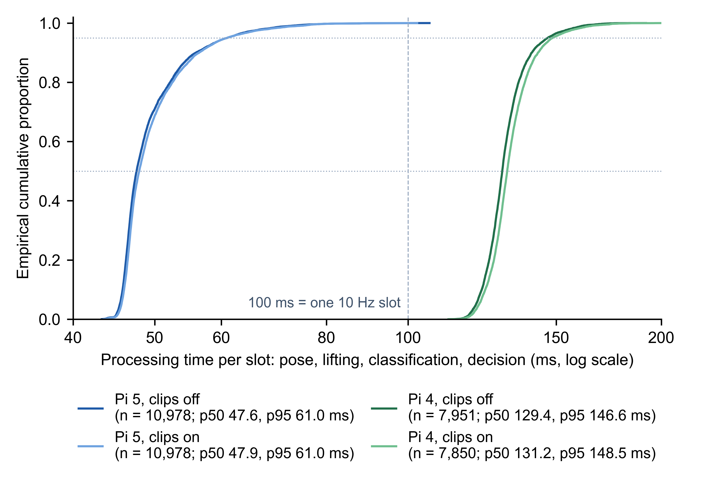

# Evidence for the Fall-Relay article

This page gives the detector operating point and event rule used by the bundled detector (Table E1), the full conditions and observations of the deterministic checks (Table E2) and the per-slot processing-time distributions of the replay trials (Figure E1). The detector's accuracy is not evaluated in the article or here. The accompanying files are aggregated measurements (CSV and JSON), check reports and the browser verification record; no video, clip, image of a person or database file is included.

## Table E1. Detector operating point and event rule

**Table E1.** Settings of the bundled detector that determine when an event opens and closes. They are the values of the reference deployment, of the hardware-free example and of the replay trials of Section 3.3.

| Item | Value | Note |
|---|---|---|
| Decision slot | 100 ms | 10 slots per second at the design rate |
| Input window | 20 slots | the detector scores the pose sequence of the last 20 slots |
| Valid slot | both hips and ≥ 8 of 13 joints visible | |
| Eligible slot | valid, and ≥ 10 of the last 20 slots valid | |
| Score threshold θ | 0.95 | detector score per slot |
| Open rule (k / n / m) | 3 / 5 / 3 | at least k of the last n slots score ≥ θ and at least m are eligible |
| Close rules | upright ≥ 3 s; no eligible input ≥ 10 s; age 600 s; runtime stop | the event is latched until one of these holds |
| Cooldown after close | 0 s | the deployment and the replay trials use no cooldown |

## Table E1b. Devices of the reference deployment and the replay trials

| Device | SoC, memory, cooling | OS, Python | Camera |
|---|---|---|---|
| Raspberry Pi 5 | BCM2712, 4 cores at 2.0 GHz (`arm_freq=2000` in `config.txt`; the board default is 2.4 GHz), 4 GB RAM, active cooler | Debian 13, Python 3.13 | Raspberry Pi Camera Module 3 |
| Raspberry Pi 4 Model B | BCM2711, 4 cores at 1.8 GHz, 8 GB RAM, aluminium armour case with two fans | Raspberry Pi OS Bookworm (Debian 12) 64-bit, Python 3.11 | Arducam IMX519 |

Server host of the trials: the laboratory workstation that also runs the bridge and the web application (WSL2; `replay/uptime_start.json` records its kernel). No thermal throttling was recorded on either device during the trials.

## Table E2. Deterministic checks: conditions and observations

**Table E2.** Full conditions, observations and scope of the checks summarised in Table 2(A) of the article (SoftwareX submission). All 29 check scripts passed on 27 October 2026 (local time; the report records 2026-10-27T10:49 UTC) in an isolated environment with temporary databases; `server/bridge/run_checks.py --report` writes the report included with this page.

| Check | Condition | Observed result | Scope |
|---|---|---|---|
| A1 Lost response | Server commits, response dropped; same message resent; bridge restarted | Send sequence 1, 1, 2, 3, 4; unacknowledged 4 → 0; one event, one alert, one dispatch job; same result with the deployed decision engine and outbox over loopback HTTP, including a bridge restart with a retained open event | No wide-area latency or availability measured |
| A2 Killed process | Child process driving the outbox module killed (SIGKILL) after local commit; restarted with the same outbox | 1 message pending after the kill; recovery added the runtime_stop close (2 pending); both then delivered with no lost or duplicate event | Outbox module driven directly in a child process; the full edge runtime process was not killed; power loss not tested |
| A3 Outage, errors, capacity | Simulated 600 s outage; HTTP 403; mismatching receipt; queue capacity 1 | 2 messages kept during outage, 0 after reconnect; 403 blocked until explicit retry; mismatching receipt refused; at capacity an update was refused and the close stored | Outage time simulated, not a real 10 min disconnection |
| A4 Engine integration | Synthetic scores and poses → decision engine → outbox → bridge over HTTP | Recovered event with 7 messages (open, 5 updates, close); runtime_stop event with 2; 2 events, 2 alerts; resent open acknowledged as duplicate | No camera or model inference |
| A5 Any-detector adapter | `edge/examples/any_detector_adapter.py` run on `sample_scores.csv` against a bridge (`edge/test_any_detector_adapter.py`) | One event closed as recovered; a receipt for every message in sequence order; one fall alert; no model-run record | Scores from a file; no heartbeats, camera or model inference |
| B1 Concurrent handling | Two threads acknowledge one alert; late receipt; invalid outcome | One success, one HTTP 409; no state regression; invalid outcome 422, valid outcome stored | API and store level; no real concurrent browsers |
| B2 Stream resumption | Paged log reads; SSE reader interrupted and resumed; store reopened | 1,102 log rows received exactly once: 507 distinct cursors before the interruption and rows 508–1,102 after resumption; camera isolation and resynchronisation after an unknown cursor | Log rows, not 1,102 distinct alerts |
| B3 Role and camera scope | Other camera's alert; viewer acknowledgement; another user's receipt | Expected 403/404 responses; stream isolated per camera | Trusted identity injected; not a security audit |
| C1 Late arrival | Event older than 120 s; unreliable clock; retries after classification; restart | Classified manual review and excluded from sound, notification, repeats and reminders; live alerts kept them until acknowledged; classification unchanged by retries or by the migration | Server classification checked in the repository on the bridge's SQLite test store and, with FALLRELAY_DATABASE_URL set, in a temporary PostgreSQL schema; browser behaviour verified once in Chromium with synthetic streams and virtual time (script `browser.mjs` and record `browser-verification.json` in this folder, 22 October 2026) |

## Figure E1. Per-slot processing time

*Figure E1. Cumulative distribution of per-slot processing time (pose estimation to decision) on the Raspberry Pi 5 and Raspberry Pi 4 during the NTU RGB+D replay (2 × 20 min per condition), without and with event clips; log scale. Medians and 95th percentiles are those of Table 3 of the article. | width=140mm*

## Real link loss on a device (27 October 2026)

`link_loss/pi4_gated/` and `link_loss/pi5_gated/` hold the aggregates of two further 20-min replays (clips off, the
protocol of the replay trials) in which a TCP gate on one device (`link_loss/link_gate.py`, between the benchmark
process and the SSH tunnel to the bridge) held every connection to the server for 180 s, twice, 300 s and 720 s into the
measurement, while the other device ran ungated as a control. In the first trial the Raspberry Pi 4 was gated; in the
second the Raspberry Pi 5. In each folder `linkcut_summary.json` is the output of `link_loss/analyze_linkcut.py`;
`linkcut_events.csv` has one row per event decided during the measurement (decision time, whether it fell in a cut,
server and browser receipt, late-arrival classification, receipt order, attempts); `linkcut_outbox_series.csv` is the
1-s series of messages pending in each device's outbox; `cuts.jsonl` and `schedule.json` are the controller's timing
records. `link_loss/outbox_backlog.png` is Fig. 5 of the article (both trials).

| Gated device | Pi 4 | Pi 5 |
|---|---|---|
| Processed slots / expected (achieved rate) | 3,968 / 5,489 (7.31 Hz) | 5,489 / 5,489 (10.11 Hz) |
| Events decided in the measurement / during the cuts | 36 / 9 (8 + 1) | 38 / 9 (8 + 1) |
| Events stored at the server / duplicates / blocked messages | 36 / 0 / 0 | 38 / 0 / 0 |
| Outbox messages / attempts / timed-out attempts (all during cuts) | 72 / 137 / 65 | 86 / 152 / 66 |
| Peak pending messages, first and second cut | 16, 2 | 17, 3 |
| Backlog cleared after restore, first and second cut | 51.3 s, 32.2 s | 60.7 s, 30.9 s |
| Delivery of messages created during the first cut, after restore (min / median / max) | 1.7 / 25.1 / 50.3 s | 3.9 / 28.9 / 60.1 s |
| Alerts classified live / manual review (clock unreliable / event too old) | 26 / 10 (9 / 1) | 29 / 9 (8 / 1) |
| Live alerts received by the browser | 26 of 26 | 29 of 29 |
| Receipts in sequence order for every event | yes | yes |
| Control device: events decided / stored / at browser; retried messages | Pi 5: 38 / 38 / 38; 0 | Pi 4: 32 / 32 / 32; 0 |

In each trial the nine events decided during a cut were classified for manual review: eight because the clock
calibration taken at the decision failed while the link was dead (recorded round trip 60 s, the failure value), one
because the event was more than 120 s old at receipt. In the Pi 4 trial one further event, decided 2 s after the second
restore and delivered at once, was classified for review because the device had not yet re-calibrated its clock. Both
devices had been up for 3.9 h before the Pi 4 trial and 4.3 h before the Pi 5 trial, and the server host for 4.9 h and 5.3 h (`uptime_start.json`); the
bridge process had been started 3.0 h and 3.4 h earlier, when the released software version was deployed. The raw device records
(slots, transport attempts, outbox database, resource log) and the browser and server logs are kept outside the
repository with the records of the replay trials.

## Files

| File | Content |
|---|---|
| `replay/summary.json` | Per-trial aggregates of the replay (decision rate, missed slots, processing percentiles, CPU, temperature, throttling, HTTP volume, events, outbox state) |
| `replay/uptime_start.json`, `uptime_end.json`, `unrelated_services.json` | Uptime and load of the devices and the server before and after the trials; the Pi 4 services stopped during the trials and restored afterwards |
| `replay/trials.csv` | The same aggregates as one row per trial |
| `replay/event_stages.csv` | One row per event (289): decision, server receipt, browser receipt, clock validity and stage latencies |
| `replay/outbox_creation_to_ack.csv` | One row per outbox message (619): creation, send and acknowledgement times, attempts |
| `checks/fall-relay-checks.json` | Report of the 29 check scripts |
| `link_loss/pi4_gated/…`, `link_loss/pi5_gated/…`: `linkcut_summary.json`, `linkcut_events.csv`, `linkcut_outbox_series.csv`, `cuts.jsonl`, `schedule.json`, `uptime_start.json`, `unrelated_services.json`, `completed.json` | Aggregates and timing records of the two link-loss trials (one row per event, 1-s outbox series, cut times) |
| `link_loss/link_gate.py`, `analyze_linkcut.py` | The TCP gate run on the device and the analysis script that produced the aggregates |
| `link_loss/outbox_backlog.png` | Fig. 5 of the article, both trials (600 dpi PNG) |
| `late_alert_policy/browser.mjs`, `browser-verification.json` | Browser verification of the late-arrival policy |
| `processing_time_cdf.pdf`, `.png` | Figure E1 as vector PDF and 600 dpi PNG |
